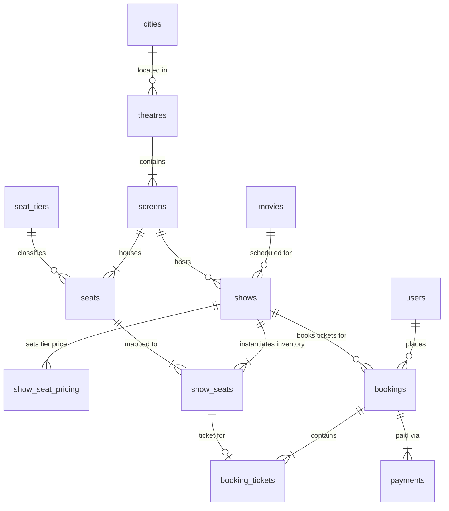

# BookMyShow: Database Design & Show Scheduling Case Study

A comprehensive, normalized relational database system design and SQL implementation for a movie ticketing platform like **BookMyShow**. This case study models theatres, screens, seat layouts, movie screenings across a 7-day rolling window, real-time seat inventory locks, and answers P1 (Schema, Normalization to BCNF, Sample Data) and P2 (Shows & Timings Query).

---

## 1. Problem Statement Overview

In BookMyShow:
1. For any selected theatre, users can browse the **next 7 calendar dates**.
2. Selecting a date returns all movies and shows running in that theatre on that specific day, along with their respective screen formats (2D, 3D, IMAX 4K, 4DX) and show timings.
3. Users can select seats categorized by pricing tiers (Classic, Prime, Recliner) and hold them for checkout.

---

## 2. Entity Identification & Attributes (P1)

| Entity | Attributes | Description |
|---|---|---|
| **cities** | `id`, `name`, `state`, `country` | Geographic classification of theatre locations. |
| **theatres** | `id`, `name`, `city_id`, `address`, `total_screens` | Physical multiplex/cinema property. |
| **screens** | `id`, `theatre_id`, `screen_number`, `screen_name`, `sound_system`, `projection_type`, `total_capacity` | Individual auditorium within a multiplex. |
| **seat_tiers** | `id`, `name`, `description` | Standardized seat classes (e.g., `CLASSIC`, `PRIME`, `RECLINER`). |
| **seats** | `id`, `screen_id`, `seat_tier_id`, `row_code`, `seat_number`, `is_active` | Physical seats mapped to a screen and tier. |
| **movies** | `id`, `title`, `language`, `genre`, `duration_minutes`, `censor_rating`, `release_date`, `description` | Motion picture metadata. |
| **shows** | `id`, `movie_id`, `screen_id`, `show_date`, `start_time`, `end_time`, `format_type`, `status` | Scheduled movie screening event on a specific date/time. |
| **show_seat_pricing** | `id`, `show_id`, `seat_tier_id`, `price` | Dynamic pricing configuration per show per tier. |
| **users** | `id`, `name`, `email`, `phone` | Registered customer identity. |
| **bookings** | `id`, `booking_reference`, `user_id`, `show_id`, `total_amount`, `booking_status` | Purchase order capturing reserved tickets. |
| **show_seats** | `id`, `show_id`, `seat_id`, `status`, `booking_id`, `lock_expires_at` | Real-time seat inventory state (`AVAILABLE`, `LOCKED`, `BOOKED`). |
| **booking_tickets**| `id`, `booking_id`, `show_seat_id`, `ticket_price` | Granular ticket item linking a seat instance to a booking. |
| **payments** | `id`, `booking_id`, `payment_reference`, `payment_method`, `amount`, `status` | Financial transaction audit. |

---

## 3. Database Normalization Proofs (1NF, 2NF, 3NF, BCNF)

### First Normal Form (1NF)
- **Rule**: Every column must contain atomic (indivisible) scalar values; no multivalued attributes or repeating groups; every table must possess a primary key.
- **Compliance**:
  - `show_timings` are NOT stored as comma-separated lists (`"10:00, 14:30, 19:00"`) inside `shows`. Each showtime is a distinct record with atomic `start_time` and `end_time`.
  - Seats are uniquely identified by `(screen_id, row_code, seat_number)` rather than comma-separated seat lists in a booking.

### Second Normal Form (2NF)
- **Rule**: Must be in 1NF and have NO partial dependencies: every non-prime attribute must depend on the whole of every candidate key, not a proper subset.
- **Compliance**:
  - In a composite design like `ShowSeats(show_id, seat_id, screen_name, movie_title)`, `movie_title` depends only on `show_id`, not `seat_id`.
  - Our design isolates `movies`, `shows`, `screens`, and `seats` into dedicated tables with surrogate primary keys (`id`). All non-prime attributes in `show_seats` (`status`, `lock_expires_at`) depend fully on the primary key.

### Third Normal Form (3NF)
- **Rule**: Must be in 2NF and have NO transitive dependencies ($X \to Y$ and $Y \to Z$ where $Z$ is non-prime and $Y$ is not a superkey).
- **Compliance**:
  - `theatres` contains `city_id`, while state and country reside in `cities`. `theatres` does not store `state` or `country`, avoiding the transitive dependency $\text{theatre\_id} \to \text{city\_id} \to \text{state}$.
  - `shows` references `screen_id`, which references `theatre_id`. `shows` does NOT store `theatre_id`, eliminating $\text{show\_id} \to \text{screen\_id} \to \text{theatre\_id}$.

### Boyce-Codd Normal Form (BCNF)
- **Rule**: A table is in BCNF if for every non-trivial functional dependency $X \to Y$, $X$ is a **superkey**.
- **Compliance**:
  - In `seats`, the candidate key is `(screen_id, row_code, seat_number)`. The functional dependency `(screen_id, row_code, seat_number) -> (id, seat_tier_id, is_active)` has a determinant that is a superkey.
  - In `shows`, `(screen_id, show_date, start_time)` is a candidate key ensuring that an auditorium cannot screen two films at the same time. Its determinant is a superkey.
  - No non-trivial functional dependency exists whose determinant is not a superkey. Thus, the schema strictly satisfies BCNF.

---

## 4. Entity-Relationship Diagram



---

## 5. Solution to Problem P2: Shows & Timings Query

The query below retrieves all shows running on a given date (`'2026-12-01'`) at a given theatre (`Theatre ID: 1`), including movie title, format, screen name, show timings, and live seat availability:

```sql
SELECT 
    t.name AS theatre_name,
    m.title AS movie_title,
    m.language AS movie_language,
    m.censor_rating,
    CONCAT(FLOOR(m.duration_minutes / 60), 'h ', MOD(m.duration_minutes, 60), 'm') AS movie_duration,
    s.format_type,
    sc.screen_name,
    TIME_FORMAT(s.start_time, '%h:%i %p') AS show_start_time,
    TIME_FORMAT(s.end_time, '%h:%i %p') AS show_end_time,
    s.show_date,
    sc.total_capacity,
    COALESCE(COUNT(CASE WHEN ss.status = 'AVAILABLE' THEN 1 END), sc.total_capacity) AS available_seats,
    CASE 
        WHEN COALESCE(COUNT(CASE WHEN ss.status = 'AVAILABLE' THEN 1 END), sc.total_capacity) = 0 THEN 'SOLD OUT'
        WHEN COALESCE(COUNT(CASE WHEN ss.status = 'AVAILABLE' THEN 1 END), sc.total_capacity) < 10 THEN 'FILLING FAST'
        ELSE 'AVAILABLE'
    END AS availability_status
FROM shows s
JOIN screens sc ON s.screen_id = sc.id
JOIN theatres t ON sc.theatre_id = t.id
JOIN movies m ON s.movie_id = m.id
LEFT JOIN show_seats ss ON s.id = ss.show_id
WHERE t.id = 1                           -- Given Theatre ID
  AND s.show_date = '2026-12-01'          -- Given Date
  AND s.status = 'ACTIVE'
GROUP BY 
    s.id, t.name, m.title, m.language, m.censor_rating, m.duration_minutes,
    s.format_type, sc.screen_name, s.start_time, s.end_time, s.show_date, sc.total_capacity
ORDER BY 
    s.start_time ASC;
```

### Sample Output

| theatre_name | movie_title | movie_language | format_type | screen_name | show_start_time | show_end_time | available_seats | availability_status |
|---|---|---|---|---|---|---|---|---|
| PVR ICON: Phoenix Palladium | Dune: Part Two | English | IMAX 2D | Audi 1 - IMAX Laser | 10:00 AM | 01:00 PM | 25 | AVAILABLE |
| PVR ICON: Phoenix Palladium | Oppenheimer | English | 4K Dolby Atmos | Audi 2 - Dolby Atmos | 11:15 AM | 02:30 PM | 30 | AVAILABLE |
| PVR ICON: Phoenix Palladium | Dune: Part Two | English | IMAX 2D | Audi 1 - IMAX Laser | 02:30 PM | 05:30 PM | 30 | AVAILABLE |
| PVR ICON: Phoenix Palladium | Fighter | Hindi | 2D | Audi 2 - Dolby Atmos | 06:30 PM | 09:30 PM | 30 | AVAILABLE |
| PVR ICON: Phoenix Palladium | Dune: Part Two | English | IMAX 2D | Audi 1 - IMAX Laser | 07:00 PM | 10:00 PM | 30 | AVAILABLE |

---

## 6. High-Concurrency Seat Locking & Transaction Management

During blockbuster ticket sales (e.g. *Avengers: Endgame* or *KGF: Chapter 2*), thousands of users attempt to reserve the same seat simultaneously.

### The Locking Protocol
1. **Redis Distributed Lock (Pre-DB Gate)**:
   - Key: `lock:show:{show_id}:seat:{seat_id}`
   - `SET lock:show:1:seat:10 client_uuid NX EX 600` (10-minute hold TTL).
   - Instant fail-fast for contending users without touching database connection pools.
2. **Database Atomic Transition**:
   ```sql
   UPDATE show_seats 
   SET status = 'LOCKED', 
       booking_id = @booking_id, 
       lock_expires_at = DATE_ADD(NOW(), INTERVAL 10 MINUTE)
   WHERE show_id = 1 
     AND seat_id IN (10, 11) 
     AND (status = 'AVAILABLE' OR (status = 'LOCKED' AND lock_expires_at < NOW()));
   ```
   If the rows affected count does not match the requested seat count, the transaction rolls back immediately.
3. **Checkout Expiry Cron**:
   - A background worker runs every 30 seconds resetting expired locks:
   ```sql
   UPDATE show_seats SET status = 'AVAILABLE', booking_id = NULL, lock_expires_at = NULL
   WHERE status = 'LOCKED' AND lock_expires_at < NOW();
   ```
